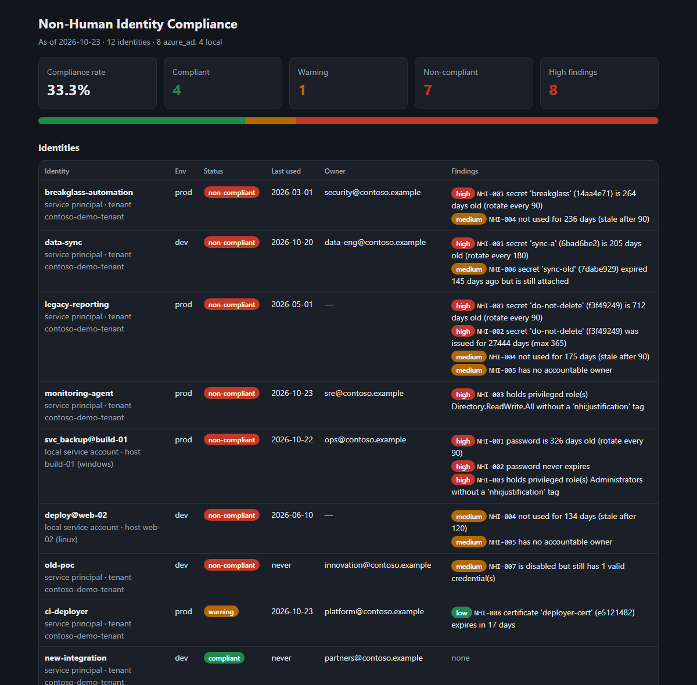
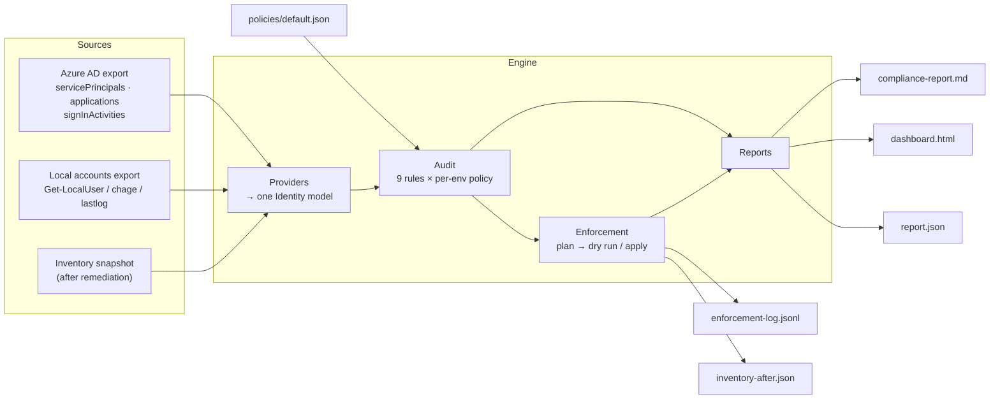
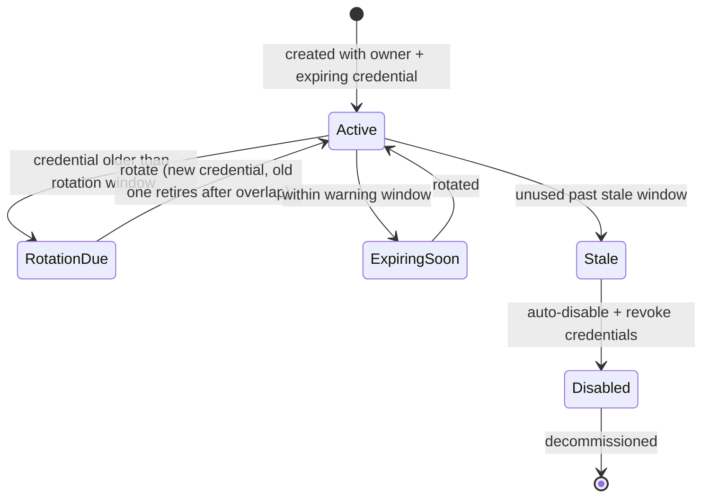
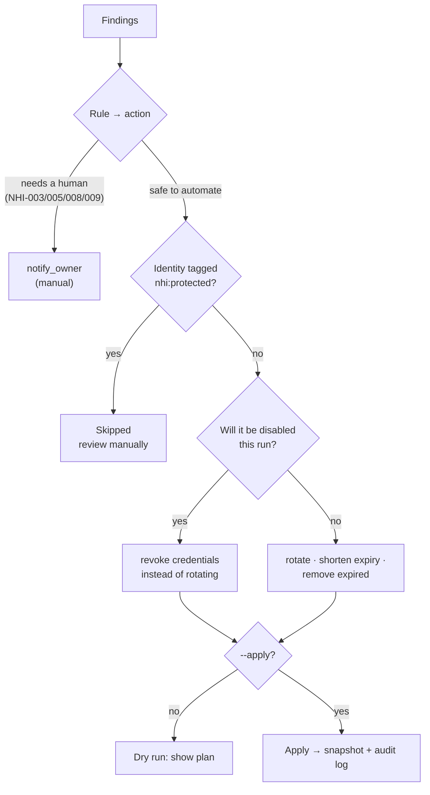

# NHI Governance Engine

A Python engine for **non-human identity (NHI) lifecycle governance**. It inventories service principals and service accounts, audits their credentials and usage against policy, plans and applies automated expiration and remediation, and produces a compliance report and dashboard.

Non-human identities (app registrations, service principals, service accounts) now outnumber people in most environments. Their secrets tend to be long-lived, shared and forgotten, so they're an easy way in. This engine makes them visible and keeps them inside policy.




---

## Table of Contents

1. [What It Does](#1-what-it-does)
2. [Architecture](#2-architecture)
3. [Quick Start](#3-quick-start)
4. [Inventory Sources](#4-inventory-sources)
5. [Policy](#5-policy)
6. [Audit Rules](#6-audit-rules)
7. [Automated Enforcement](#7-automated-enforcement)
8. [Reports and Dashboard](#8-reports-and-dashboard)
9. [Running in CI](#9-running-in-ci)
10. [Testing](#10-testing)
11. [Project Structure](#11-project-structure)
12. [Roadmap](#12-roadmap)
13. [License](#13-license)

---

## 1. What It Does

| Capability | Detail |
|---|---|
| **Inventory** | Azure AD (Entra ID) service principals with their client secrets, certificates and sign-in activity; local service accounts on Windows and Linux hosts. All are mapped to one identity model. |
| **Credential age audit** | Flags secrets, certificates and passwords older than the rotation window, with stricter windows per environment (90 days in prod, 180 in dev) |
| **Expiration policy** | Flags non-expiring and over-long credentials, warns before expiry, and catches expired credentials left attached |
| **Last-used tracking** | Flags identities unused for too long, or never used after their grace period |
| **Ownership and privilege** | Requires an accountable owner; privileged roles need a recorded justification |
| **Automated remediation** | Rotates, shortens expiry, removes dead credentials and disables stale identities. Dry run by default; protected identities are never touched. |
| **Compliance output** | Markdown report, self-contained HTML dashboard, JSON, and an exit code for CI gating |

The repository ships with a **simulated** environment: a fictional Contoso tenant with 8 service principals and two servers with 4 service accounts. Each identity has a specific, realistic problem planted in it. The Azure data is shaped exactly like Microsoft Graph output, so a real export (or a live Graph connector) drops in without code changes.

---

## 2. Architecture



### The lifecycle it governs



---

## 3. Quick Start

```bash
git clone https://github.com/JoshuaOmosa/nhi-governance-engine.git
cd nhi-governance-engine
export PYTHONPATH=src            # PowerShell: $env:PYTHONPATH = "src"
SRC="--azure sample_data/azure_ad_export.json --local sample_data/local_accounts.json --as-of 2026-10-23T06:00:00Z"

python -m nhi_gov audit   $SRC                                          # summary + findings
python -m nhi_gov report  $SRC --format html --with-plan --out output/dashboard.html
python -m nhi_gov enforce $SRC                                          # dry run: show the plan
python -m nhi_gov enforce $SRC --apply                                  # apply safe actions
python -m nhi_gov audit   --snapshot-in output/inventory-after.json --as-of 2026-10-23T06:00:00Z
```

`--as-of` pins the evaluation date so the sample results are reproducible; leave it off to evaluate as of now. `pip install .` installs an `nhi-gov` command.

Audit output on the sample:

```text
As of 2026-10-23: 12 identities, 33.3% compliant (4 compliant, 1 warning, 7 non-compliant)
Findings: 8 high, 7 medium, 1 low

[NON_COMPLIANT] legacy-reporting (prod)
  high   NHI-001  secret 'do-not-delete' (f3f49249) is 712 days old (rotate every 90)
  high   NHI-002  secret 'do-not-delete' (f3f49249) was issued for 27444 days (max 365)
  medium NHI-004  not used for 175 days (stale after 90)
  medium NHI-005  has no accountable owner

[NON_COMPLIANT] svc_backup@build-01 (prod)
  high   NHI-001  password is 326 days old (rotate every 90)
  high   NHI-002  password never expires
  high   NHI-003  holds privileged role(s) Administrators without a 'nhi:justification' tag
...
```

After `enforce --apply`, re-auditing the snapshot shows compliance rising to **50%**. Everything still open needs a person: the protected break-glass identity, two privileged roles missing a justification, two identities without an owner, and one certificate about to expire. The full example report is in [docs/sample-report.md](docs/sample-report.md).

---

## 4. Inventory Sources

### Azure AD service principals

The export combines three Microsoft Graph responses, joined by `appId`:

| Graph call | Used for |
|---|---|
| `GET /servicePrincipals` (+ `owners`, `appRoleAssignments`) | Name, enabled, created, tags, owners, roles |
| `GET /applications` | `passwordCredentials` (client secrets) and `keyCredentials` (certificates) with start/end dates |
| `GET /reports/servicePrincipalSignInActivities` | `lastSignInActivity.lastSignInDateTime` (last used) |

Tags drive governance metadata: `env=prod`, `nhi:justification=CHG-2041 …`, `nhi:protected=true`.

### Local service accounts

One entry per host, with the fields Windows `Get-LocalUser` (`PasswordLastSet`, `PasswordExpires`, `LastLogon`) or Linux `chage -l` / `lastlog` provide, plus group membership and owner. The password is treated as the account's credential.

### Adding a source

Write a function that returns `list[Identity]` and register it in `providers/__init__.py`. The audit, enforcement and reports work on it unchanged.

---

## 5. Policy

`policies/default.json` sets the thresholds, with per-environment overrides that inherit everything else:

```json
{
  "defaults": {
    "max_credential_age_days": 180,
    "max_credential_lifetime_days": 365,
    "expiry_warning_days": 30,
    "stale_after_days": 90,
    "never_used_grace_days": 30,
    "max_active_credentials": 2,
    "require_owner": true,
    "privileged_roles": ["Directory.ReadWrite.All", "Application.ReadWrite.All", "Administrators", "sudo"],
    "auto_disable_stale": true,
    "rotation_overlap_days": 7
  },
  "environments": {
    "prod": { "max_credential_age_days": 90 },
    "dev":  { "stale_after_days": 120 }
  }
}
```

Unknown keys, wrong types and contradictory values (e.g. rotation window longer than the maximum lifetime) are rejected when the policy loads.

---

## 6. Audit Rules

| Rule | Severity | Flags | Automatic action |
|---|---|---|---|
| NHI-001 | high | Credential older than the rotation window | Rotate |
| NHI-002 | high | Credential that never expires, or was issued for longer than the maximum lifetime | Shorten expiry |
| NHI-003 | high | Privileged role without an `nhi:justification` tag | Notify owner |
| NHI-004 | medium | Unused past `stale_after_days`, or never used after the grace period | Disable + revoke |
| NHI-005 | medium | No accountable owner | Notify (ownership ticket) |
| NHI-006 | medium | Expired credential still attached | Remove |
| NHI-007 | medium | Disabled identity that still has valid credentials | Revoke |
| NHI-008 | low | Credential expiring within the warning window | Notify owner |
| NHI-009 | low | More active credentials than allowed | Notify owner |

An identity is **compliant** with no findings, **warning** with only low findings, and **non-compliant** otherwise.

**Rotation overlap.** After a rotation, the old credential stays valid for `rotation_overlap_days`, so running workloads can switch over. A credential that expires within that window *and* has a newer replacement is treated as **retiring** and isn't counted as a violation. This is worked out from dates alone, so it applies to fresh Graph exports too, not just to the engine's own snapshots.

---

## 7. Automated Enforcement



Safety rules:

- **Dry run by default.** Nothing changes without `--apply`.
- **Protected identities are never changed automatically.** Break-glass and emergency accounts tagged `nhi:protected=true` are reported, and their actions are marked for manual review.
- **Disabling beats rotating.** An identity that's about to be disabled has its credentials revoked, rather than being issued fresh ones.
- **Rotation keeps an overlap.** The new credential is issued and the old one expires after `rotation_overlap_days`, so nothing breaks mid-deploy.
- **Everything is logged.** Every planned and applied action goes to `enforcement-log.jsonl`, with a timestamp and whether it was applied.
- **Results can be checked.** `--apply` writes the updated inventory to a snapshot, and `audit --snapshot-in` re-checks it.

Because this repo works from exports, applying an action updates the snapshot. A live connector would make the same changes through Microsoft Graph (`addPassword` / `removePassword` / `addKey`, `accountEnabled: false`) or the host's account tools. That connector is on the roadmap.

---

## 8. Reports and Dashboard

```bash
python -m nhi_gov report $SRC --format md   --with-plan --out output/compliance-report.md
python -m nhi_gov report $SRC --format html --with-plan --out output/dashboard.html
python -m nhi_gov report $SRC --format json             --out output/report.json
```

| Output | Contents |
|---|---|
| **Markdown** | Summary, findings by rule, every identity with its findings, credentials expiring in the next 30 days, remediation plan. Renders on GitHub and in CI job summaries. |
| **HTML dashboard** | The same as a single self-contained page: summary cards, a compliance bar, colour-coded tables, and light and dark themes. No JavaScript and no external files. All data is HTML-escaped. |
| **JSON** | Full machine-readable result for SIEM ingestion or further tooling |

---

## 9. Running in CI

```bash
python -m nhi_gov audit $SRC --fail-on high     # exit 3 if any high finding
```

`.github/workflows/ci.yml` runs in two stages:
1. **Tests** on Python 3.10 and 3.12.
2. **Compliance run**, which:
   - writes the Markdown report into the GitHub job summary
   - checks that `--fail-on high` really fails on the sample's planted high findings
   - applies enforcement and re-audits the result
   - uploads the report, dashboard, log and snapshot as an artifact

It also runs **weekly on a schedule**, as a recurring compliance check.

| Exit code | Meaning |
|---|---|
| 0 | Success (no finding at or above `--fail-on`) |
| 2 | Bad input: missing file, invalid policy, unknown source |
| 3 | Findings at or above the `--fail-on` severity |

---

## 10. Testing

```bash
python -m unittest discover -s tests -t . -v
```

The 51 tests use the standard library only:

- **Inventory:** Graph join by `appId`, tags, sign-in activity, local accounts, duplicate detection, snapshot round trip.
- **Rules:** every rule, both triggering and not triggering at its threshold. Rotation-overlap handling. Policy inheritance and validation.
- **Sample data:** every identity's planted problems are caught exactly, and nothing else is flagged.
- **Enforcement:**
  - plan mapping, protected identities, "disable beats rotate", and the auto-disable switch
  - dry run changes nothing
  - each action's real effect, and the audit log
- **End to end:** apply, then re-audit, leaves only findings that need a person.
- **Reports and CLI:** report sections, HTML escaping of hostile names, JSON validity, exit codes, error handling.

---

## 11. Project Structure

```text
nhi-governance-engine/
├── src/nhi_gov/
│   ├── models.py            # Identity / Credential model, time + tag parsing
│   ├── providers/
│   │   ├── azure_ad.py      # Graph-shaped export → identities
│   │   ├── local_accounts.py
│   │   └── snapshot.py      # the engine's own format (after --apply)
│   ├── policy.py            # thresholds + per-environment overrides, validated
│   ├── audit.py             # the 9 rules, retiring-credential logic, scoring
│   ├── enforce.py           # remediation plan, dry run / apply, audit log
│   ├── report.py            # Markdown, HTML dashboard, JSON, CI threshold
│   └── cli.py               # audit | report | enforce
├── policies/default.json
├── sample_data/             # simulated Contoso tenant + two hosts
├── docs/                    # sample report + dashboard screenshot
├── tests/
├── .github/workflows/ci.yml
└── pyproject.toml
```

---

## 12. Roadmap

- [ ] Live Microsoft Graph connector (read inventory and apply actions with an app registration)
- [ ] AWS IAM users and access keys, and GCP service-account keys, as sources
- [ ] Ownership attestation: owners confirm each identity periodically
- [ ] Ticket integration for `notify_owner` actions (Jira / ServiceNow)
- [ ] Trend history: compliance rate over time across runs

---

## 13. License

MIT. See [LICENSE](LICENSE).
